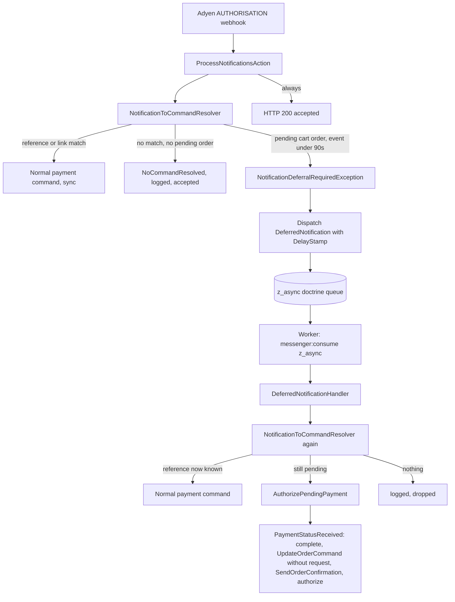

# Requirements

### Overview & Goals
Replace the `503 [retry-later]` mechanism of the Bancontact Pay pending-payment fallback with **Symfony Messenger queuing (option A)**. The webhook endpoint answers `[accepted]` immediately. The notification that needs the grace period is processed later by a worker, after about 90 s, against fresh database state. Adyen no longer sees "Failed" deliveries, retry queues or failure alerts.

The main project `zangra-sylius` was analysed and needs small changes so that an order can be finalised from a worker (no HTTP request).

### Scope
**In scope**
- AdyenPlugin: a delayed async message, its handler, an adapted resolver exception, `ProcessNotificationsAction` without the 503 path, an idempotency guard in `AuthorizePendingPaymentHandler`, unit tests, updated `docs/bancontact-pay-pending-payment-fallback.md`.
- zangra-sylius: Messenger routing of the new message to the existing `z_async` transport, and a request-less safe `UpdateOrderCommand` / `UpdateOrderHandler`.

**Out of scope**
- Queuing all notifications (option B) or any other event code. Only the "no reference match, pending cart order found" case is deferred.
- Fixing why the customer's return flow failed on order `000185191`.
- The 10 `ClientPayloadFactoryTest` errors and the PHPStan error.
- Production worker provisioning (supervisor/systemd). It is documented, not created.

### User Stories
- As the shop owner, I want Adyen to always get `[accepted]` so that the webhook endpoint is never flagged as failing.
- As the shop owner, I want a paid Bancontact Pay order to be finalised (visible in admin, confirmation e-mail) even if the customer never returns.
- As the customer, I want my own return to the shop not to be raced by the webhook.

### Functional Requirements
1. A successful `authorisation` that matches no stored reference but matches a pending cart order (existing guards) is **not** handled in the HTTP request. The response is `[accepted]` (HTTP 200) and a message is queued with a delay so that processing happens about 90 s after `eventDate`.
2. The worker re-resolves the notification with fresh state:
   - reference now known (customer returned) -> normal payment command (same as a redelivered webhook today);
   - still unknown, order still in `cart` -> `AuthorizePendingPayment` (checkout complete, confirmation, authorize/capture);
   - nothing matches -> logged on the `adyen` logger, message dropped.
3. Running twice for the same notification is safe (Adyen may send duplicates).
4. Unsuccessful or unrelated notifications behave as today (logged, accepted, not queued).
5. In the worker the order is finalised without an HTTP request: `customerIp`, currency and locale of the order are not overwritten.

### Non-Functional Requirements
- Needs a running `messenger:consume z_async` worker. In zangra-sylius this is already required because `SendOrderConfirmation` is routed to `z_async`.
- Failed messages go to the existing `failed` transport (global `failure_transport`).
- Plugin stays compatible with `symfony/messenger ^6.4 || ^7.2`.

# Technical Design

### Current Implementation
**AdyenPlugin** (branch `zs2.0`, last commit `ad09b25`)
- `ProcessNotificationsAction` resolves a command per notification item with `NotificationToCommandResolver` and dispatches it **synchronously** on `sylius.command_bus` (injected as `MessageBusInterface`, `config/services/responders.xml`). `PaymentNotificationResolver` throws `NotificationRetryRequiredException` when the `merchantReference` fallback matches but `eventDate` is younger than `PENDING_PAYMENT_GRACE_PERIOD = 90`; the action then answers `503 [retry-later]`.
- `AuthorizePendingPayment` holds a `PaymentInterface` **entity**. That is fine for the sync bus but must never be put on an async transport.
- `NotificationItemData` and `Amount` are plain public-property DTOs, so they serialize with Messenger's default PHP serializer.

**zangra-sylius** (requires `sylius/adyen-plugin` `dev-zs2.0`, Symfony Messenger 6.4.47)
- `config/packages/messenger.yaml`: transport `z_async` (`MESSENGER_TRANSPORT_DSN=doctrine://default`, queue `zangra_default`), global `failure_transport: failed` (doctrine), `reset_on_message: true`. `SendOrderConfirmation` is already routed to `z_async`, so a production worker must already exist. `docker-compose.yml` has a `worker` service: `messenger:consume z_async --time-limit=3600`, `restart: unless-stopped`. No supervisor/systemd file is in the repo.
- `App\Bus\Handler\PaymentStatusReceivedHandler` (overrides the plugin handler, `config/services/overrides.yaml`) dispatches `new UpdateOrderCommand($this->requestStack->getMainRequest(), $token)`. `UpdateOrderCommand::__construct(Request $request, ...)` is **not nullable**, so in a worker (`getMainRequest() === null`) this throws a `TypeError`.
- `App\Bus\Handler\UpdateOrderHandler` calls `$request->getClientIp()`, `CurrencyContext::getCurrencyCode()` and `LocaleContext::getLocaleCode()` unconditionally. In a worker the currency/locale contexts have no request and are not safe to call. The rest of the handler (wallet, exchange rate in `OrderOperator`, e-mails) does not use a request.
- State machine listeners on the complete path (`PaymentCompletedListener`, `PaymentPreCompleteListener`) already use `getCurrentRequest()?->` null-safely.

### Key Decisions
1. **Option A, scoped to the pending-payment case.** Only the case that currently throws the retry exception is deferred. Everything else stays synchronous.
2. **The message carries scalars/DTOs only:** `string $paymentMethodCode` + `NotificationItemData`. The worker re-runs `NotificationToCommandResolver` against fresh state. This covers both outcomes (customer returned -> reference match -> normal command; not returned -> `AuthorizePendingPayment`) and avoids serializing entities.
3. **The delay is set by the controller:** `DelayStamp` = remaining grace time (from the exception) + 1 s. The resolver keeps its `eventDate` grace check, so the same code serves the intake (defer) and the worker (process).
4. **Routing lives in the host application.** The plugin cannot know the transport name. zangra-sylius routes the new message class to `z_async`.
5. **Safety net instead of silent racing.** If the worker still finds the event too recent (for example the message is routed `sync`), the handler throws `RecoverableMessageHandlingException` with a retry delay. Async: Messenger retries later. Sync: the webhook fails and Adyen retries, which is the old behaviour. No busy loop.
6. **`AuthorizePendingPaymentHandler` becomes idempotent:** it returns without changes when the order is no longer in `cart` or the payment is no longer pending. Duplicate notifications therefore cannot double-complete an order.
7. **zangra-sylius makes `UpdateOrderCommand::$request` nullable** and `UpdateOrderHandler` skips the IP/currency/locale overwrite when it is `null`. This also resolves the earlier caveat that the Adyen webhook request overwrote these values.

### Architecture Diagram


### Data Models / Contracts
```php
// Plugin: new message (scalars + DTO, safe for the PHP serializer)
namespace Sylius\AdyenPlugin\Bus\Command;
final class DeferredNotification
{
    public function __construct(
        public readonly string $paymentMethodCode,
        public readonly NotificationItemData $notificationData,
    ) {}
}

// Plugin: renamed from NotificationRetryRequiredException, now carries the delay
final class NotificationDeferralRequiredException extends \RuntimeException
{
    public function __construct(private readonly int $remainingSeconds) { parent::__construct(); }
    public function getRemainingSeconds(): int { return $this->remainingSeconds; }
}

// ProcessNotificationsAction (inside the foreach)
catch (NotificationDeferralRequiredException $e) {
    $this->messageBus->dispatch(
        new DeferredNotification($paymentMethodCode, $notificationItem),
        [new DelayStamp(($e->getRemainingSeconds() + 1) * 1000)],
    );
}
// ... always: return new Response(self::EXPECTED_ADYEN_RESPONSE);

// Plugin: handler, registered on sylius.command_bus
final class DeferredNotificationHandler
{
    public function __invoke(DeferredNotification $m): void
    {
        try {
            $this->bus->dispatch($this->resolver->resolve($m->paymentMethodCode, $m->notificationData));
        } catch (NotificationDeferralRequiredException $e) {
            throw new RecoverableMessageHandlingException('Too recent', 0, $e, ($e->getRemainingSeconds() + 1) * 1000);
        } catch (NoCommandResolvedException) {
            $this->logger->error('Deferred notification could not be resolved ...');
        }
    }
}
```
```yaml

# zangra-sylius config/packages/messenger.yaml, routing:

'Sylius\AdyenPlugin\Bus\Command\DeferredNotification': z_async
```
```php
// zangra-sylius App\Bus\Message\UpdateOrderCommand
public function __construct(private readonly ?Request $request, private readonly string $token) {}
public function getRequest(): ?Request
// UpdateOrderHandler: only when $request !== null
//   setCustomerIp, setCurrencyCode, setLocaleCode
```

### File Structure
**AdyenPlugin**
- Added: `src/Bus/Command/DeferredNotification.php`, `src/Bus/Handler/DeferredNotificationHandler.php`, `src/Resolver/Notification/NotificationResolver/NotificationDeferralRequiredException.php`, `tests/Unit/Bus/Handler/DeferredNotificationHandlerTest.php`, `tests/Unit/Controller/Shop/ProcessNotificationsActionDeferralTest.php`.
- Removed: `NotificationRetryRequiredException.php` (replaced by the new exception).
- Modified: `PaymentNotificationResolver.php`, `ProcessNotificationsAction.php`, `AuthorizePendingPaymentHandler.php`, `config/services/bus.xml`, `tests/Unit/Resolver/Notification/PaymentNotificationResolverPendingPaymentTest.php`, `docs/bancontact-pay-pending-payment-fallback.md`.

**zangra-sylius**
- Modified: `config/packages/messenger.yaml`, `src/Bus/Message/UpdateOrderCommand.php`, `src/Bus/Handler/UpdateOrderHandler.php`.

### Risks
- **No worker running in production** means paid orders stay in `cart` and the messages stay in the queue. The `z_async` worker is already needed for order confirmation e-mails, but its supervision is not in the repo. Verify, and monitor `messenger:stats` / `messenger:failed:show`.
- **Message routed `sync`** (routing forgotten): see decision 5, behaves like the old 503.
- **Several workers and duplicates:** two copies of the same notification could run in parallel. The idempotency guard in `AuthorizePendingPaymentHandler` and the Doctrine `doctrine_transaction` middleware reduce this. A lock keyed on `merchantReference` (zangra-sylius already has `framework.lock`) is a possible follow-up. Not planned.
- **Customer returns after the worker ran:** same limitation as today (browser may show an error, order and mail are correct).
- **`customerIp` stays empty** for webhook-completed orders because the webhook request is no longer used. Acceptable; the previous value was Adyen's IP.
- **In-flight 503 deliveries at deploy time:** none, Adyen retries are handled by the new code and answered `[accepted]`.

# Testing

### Validation Approach
- Run PHPUnit unit tests of the plugin in the container `zangra-sylius-php-1` (host PHP lacks `dom`/`xmlwriter`), first the changed tests, then the full unit suite. The 10 known `ClientPayloadFactoryTest` errors are expected.
- `php -l` and the container lint (`bin/console lint:container`) in zangra-sylius to validate the DI and routing changes.
- If time allows, a manual run with the Messenger `in-memory://` transport or `messenger:consume --limit=1` against the dev DB.

### Key Scenarios
- Webhook with unknown reference and a pending cart order, event 5 s old: response is `200 [accepted]`, exactly one `DeferredNotification` is dispatched with a `DelayStamp` of about 86 s, no command is dispatched synchronously.
- Same webhook with a known reference: normal command, nothing is queued.
- Handler, event now over 90 s old, order still in `cart`: `AuthorizePendingPayment` is dispatched.
- Handler, customer returned meanwhile (reference exists): normal payment command is dispatched.
- Handler, event still too recent: `RecoverableMessageHandlingException` with a retry delay.
- Handler, nothing matches: error logged, no exception.
- `UpdateOrderHandler` with `request = null`: no call to the currency/locale contexts, order otherwise processed.

### Edge Cases
- Duplicate message: second run finds the order out of `cart` and does nothing harmful.
- Failed authorisation or other event codes: not queued, same response as before.
- Notification batch with several items: only the matching item is queued, the response stays `[accepted]`.
- `eventDate` missing or unparseable: no deferral (existing behaviour), resolved immediately.

### Test Changes
- Update `PaymentNotificationResolverPendingPaymentTest` (new exception class and `getRemainingSeconds()`).
- Add `DeferredNotificationHandlerTest` and a `ProcessNotificationsAction` deferral test (mock bus, assert `DelayStamp`, assert `200`).
- Add an `AuthorizePendingPaymentHandler` idempotency case (order not in cart).
- zangra-sylius: add a test for `UpdateOrderHandler` null request only if a suitable test setup exists, otherwise rely on lint and the manual check.

# Delivery Steps

### ✓ Step 1: Defer the pending-payment notification to a delayed message (plugin intake side)
The webhook endpoint answers `[accepted]` and queues a delayed `DeferredNotification` instead of returning `503`.

- Replace `NotificationRetryRequiredException` with `NotificationDeferralRequiredException` carrying `getRemainingSeconds()`; throw it from `PaymentNotificationResolver::resolve()` when the fallback matches and the event is younger than 90 s.
- Add `Bus\Command\DeferredNotification` (`paymentMethodCode`, `NotificationItemData`).
- In `ProcessNotificationsAction`, catch the new exception, dispatch `DeferredNotification` with `DelayStamp((remaining + 1) * 1000)` on the existing `messageBus`, drop the `$retryRequired` flag and the `503 [retry-later]` response, and log an info line that the notification was queued.
- Update `PaymentNotificationResolverPendingPaymentTest` for the new exception and add a controller test (200 response, one dispatch with the expected `DelayStamp`).

### ✓ Step 2: Process the deferred message in the worker and make it idempotent (plugin worker side)
A worker run of `DeferredNotification` completes a still-pending order, or follows the normal path when the customer already returned, and is safe to repeat.

- Add `Bus\Handler\DeferredNotificationHandler` (re-resolve with `NotificationToCommandResolverInterface`, dispatch on `sylius.command_bus`, `RecoverableMessageHandlingException` with retry delay when still too recent, log and drop on `NoCommandResolvedException`) and register it in `config/services/bus.xml` with `messenger.message_handler bus="sylius.command_bus"` and the `monolog.logger.adyen` logger.
- Add the guard to `AuthorizePendingPaymentHandler`: return early if the order is not in `cart` or the payment is not in cart/new/processing.
- Add `DeferredNotificationHandlerTest` (too recent, normal command, pending command, nothing resolved) and an idempotency test for `AuthorizePendingPaymentHandler`.
- Run the plugin unit suite in container `zangra-sylius-php-1`.

### ✓ Step 3: Make zangra-sylius ready for worker-side order completion
An order can be finalised from `messenger:consume z_async` without a request, and the new message is routed to that transport.

- Add `'Sylius\AdyenPlugin\Bus\Command\DeferredNotification': z_async` to `config/packages/messenger.yaml` routing.
- Make `App\Bus\Message\UpdateOrderCommand::$request` nullable; in `App\Bus\Handler\UpdateOrderHandler` set `customerIp`, currency and locale only when the request is not null.
- Run `bin/console lint:container` and `php -l` for the changed files in the container.
- Note in the final summary that the zangra-sylius changes are plain edits and need `composer update sylius/adyen-plugin` (branch `dev-zs2.0`) plus a cache clear.

### ✓ Step 4: Update the retrospective document and rollout notes
`docs/bancontact-pay-pending-payment-fallback.md` describes the queued design instead of the 503 design.

- Update sections 4 (changes per file), 5 (flow diagram), 6 (verification), 7 (limitations: `customerIp`, worker requirement, duplicates) and 8 (rollout).
- Add a short "Superseded design" note about the `503 [retry-later]` iteration and why it was dropped (Adyen failure alerts, per-endpoint retry queue, retries not tied to the grace period).
- Rollout checklist: confirm a supervised `messenger:consume z_async` runs in production, `messenger:setup-transports` has been run, the routing is deployed, and monitor `messenger:failed:show`.