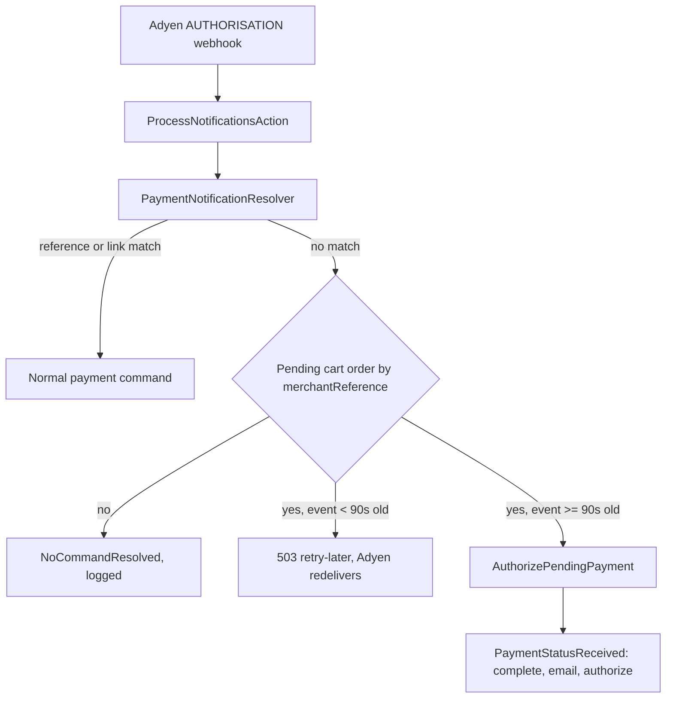

# Requirements

### Overview & Goals
Write a retrospective plan document (Markdown) that records the changes already made to the AdyenPlugin to fix Bancontact Pay orders stuck in `cart` (example: order `000185191`). The document explains the problem, the evidence from the logs, the decisions taken, what was changed, how it was verified and what remains open.

### Scope
**In scope**
- One new file: `docs/bancontact-pay-pending-payment-fallback.md` (new `docs/` folder; the repo has none yet).
- Content covers both iterations: (1) webhook fallback via `merchantReference`, (2) 90 s grace period with `503 [retry-later]`.

**Out of scope**
- No source, test or config changes.
- No changes in `zangra-sylius` (only recommendations are documented).
- No fix for the PHPStan error or the 10 `ClientPayloadFactoryTest` errors.

### Functional Requirements
The document must contain these sections:
1. Problem statement and symptoms
2. Evidence from the Adyen logs (timeline)
3. Root cause analysis
4. Changes made (per file)
5. Resulting flow (mermaid diagram)
6. Verification performed and results
7. Known limitations and open items
8. Deployment / rollout notes

Statements must stay honest: mark what is inferred and what was not verified end-to-end.

# Technical Design

### Document content (retro facts to be recorded)

**Problem.** Customer pays Bancontact Pay in the banking app; Adyen debits and sends `AUTHORISATION`, but the order stays in `cart` (invisible in admin, no confirmation mail). The `sylius_payment.details` of stuck orders still holds the `action` (type `qrCode`) entry and `resultCode: Pending`. `StuckOrderResurrector::resurrect` in zangra-sylius is the manual workaround.

**Timeline for order 000185191 (2026-10-08).**
- Payment initiation: pspReference `LB2X7X4Q2KNNG6Z3`, resultCode `Pending`, `action` qrCode (this is the reference stored in `sylius_adyen_reference`).
- 07:18:53 webhook `AUTHORISATION`, pspReference `LJNKD8M8QP8KS6G3`, paymentMethod `bcmc_mobile`, EUR 27.01.
- 07:18:53/54 plugin logs: "finished with event code [authorisation]", then "Tried to dispatch an unknown command".
- 07:18:57 `payments/details` returns `Authorised` with the same `LJNKD...` reference (request body has `redirectResult` only, no `paymentData`).

**Root cause (inferred).** The authorisation reference differs from the stored one and no payment link exists, so `PaymentNotificationResolver` threw `NoCommandResolvedException` and the webhook was only logged. The customer's return flow (`RedirectTargetAction` or `PaymentDetailsAction`) did not persist the result; the payment kept `action`. The exact failure of the return flow was not identified (needs production error log around 07:18:57).

### Changes made (per file)
| File | Change |
|---|---|
| `src/Resolver/Notification/NotificationResolver/PaymentNotificationResolver.php` | New `RepositoryInterface $orderRepository` dependency. On `NoCommandResolvedException` falls back to `fetchPendingPaymentByMerchantReference()`: only successful `authorisation`, order found by `number`, order state `cart`, payment of the same method code in state cart/new, same amount and currency. Returns `AuthorizePendingPayment`. Adds `PENDING_PAYMENT_GRACE_PERIOD = 90` and `isTooRecent()` (based on `eventDate`) which throws `NotificationRetryRequiredException`. |
| `src/Resolver/Notification/NotificationResolver/NotificationRetryRequiredException.php` | New exception: notification must not be acknowledged yet. |
| `src/Bus/Command/AuthorizePendingPayment.php` | New command (payment + `NotificationItemData`), implements `NotificationDataAwarePaymentCommand`. |
| `src/Bus/Handler/AuthorizePendingPaymentHandler.php` | Removes `action`, sets `resultCode=Authorised` and `pspReference` from the notification, dispatches `PaymentStatusReceived` (checkout complete, `SendOrderConfirmation`, authorize/capture), flushes. |
| `src/Controller/Shop/ProcessNotificationsAction.php` | Catches `NotificationRetryRequiredException`, logs info, returns `503 [retry-later]` instead of `[accepted]` so Adyen redelivers. |
| `config/services/resolvers.xml` | Passes `sylius.repository.order` to the resolver. |
| `config/services/bus.xml` | Registers the new handler. |
| `tests/Unit/Resolver/Notification/PaymentNotificationResolverPendingPaymentTest.php` | 5 tests: match, too recent, order already placed, amount mismatch, failed authorisation. |

### Key decisions to document
- Match by `merchantReference` only as a last resort and with strict guards (cart state, method, amount, currency, success).
- Reuse `PaymentStatusReceived` so the normal flow runs, no duplicated logic.
- Grace period 90 s plus `503` instead of completing immediately, to avoid racing the customer's own return (iteration 2, triggered by the log showing `payments/details` 4 s after the webhook).

### Resulting flow

### Verification and open items to document
- New unit test passes (5/5) in container `zangra-sylius-php-1`; full unit suite: 536 tests, 10 pre-existing-looking errors in `ClientPayloadFactoryTest` (not checked against baseline).
- PHPStan stopped with 1 error (not investigated).
- No end-to-end test against a real/sandbox Bancontact Pay payment.
- Remaining race: customer returning after more than ~90 s may see an error while the order is still finalised correctly.
- Minor test nit: duplicated `eventCode` assignment in `createNotification()`.
- zangra-sylius: `UpdateOrderHandler` overwrites customerIp, currency, locale from the webhook request; recommend skipping or only filling when empty.
- Deployment: commit to branch `ZNG-43`, `composer update sylius/adyen-plugin` in zangra-sylius, clear cache. Already-stuck orders: `resurrect` or redeliver the webhook while the order is still in `cart`.

### File Structure
- Added: `docs/bancontact-pay-pending-payment-fallback.md`

# Testing

### Validation Approach
- Re-read the generated Markdown against the actual code (`git diff` / file contents) to ensure every file, constant and behaviour named is accurate.
- Verify the mermaid block is syntactically valid and the table renders.

### Key Scenarios
- All eight required sections exist.
- Class names, paths, `PENDING_PAYMENT_GRACE_PERIOD = 90` and HTTP `503 [retry-later]` match the code.

### Test Changes
None; documentation only.

# Delivery Steps

### ✓ Step 1: Collect facts and draft problem/analysis sections
The first half of `docs/bancontact-pay-pending-payment-fallback.md` documents the problem, the log timeline and the root cause.

- Re-read the current versions of `PaymentNotificationResolver`, `ProcessNotificationsAction`, `AuthorizePendingPaymentHandler`, `AuthorizePendingPayment` and the unit test to confirm exact behaviour.
- Create `docs/` and the Markdown file with sections: Problem, Evidence/timeline for order `000185191`, Root cause (clearly marked as inferred).
- State the unresolved question about why the customer return flow did not persist the result.

### ✓ Step 2: Document changes, flow, verification and rollout
The document is complete with changes per file, flow diagram, verification results and open items.

- Add the per-file change table and the key decisions (merchantReference fallback guards, reuse of `PaymentStatusReceived`, 90 s grace period with `503 [retry-later]`).
- Add the mermaid flow diagram.
- Add Verification (5/5 new tests, 10 `ClientPayloadFactoryTest` errors, PHPStan error, no end-to-end run).
- Add Known limitations, zangra-sylius recommendations (`UpdateOrderHandler` overrides) and deployment/rollout notes.
- Proofread the file against the code for accuracy.