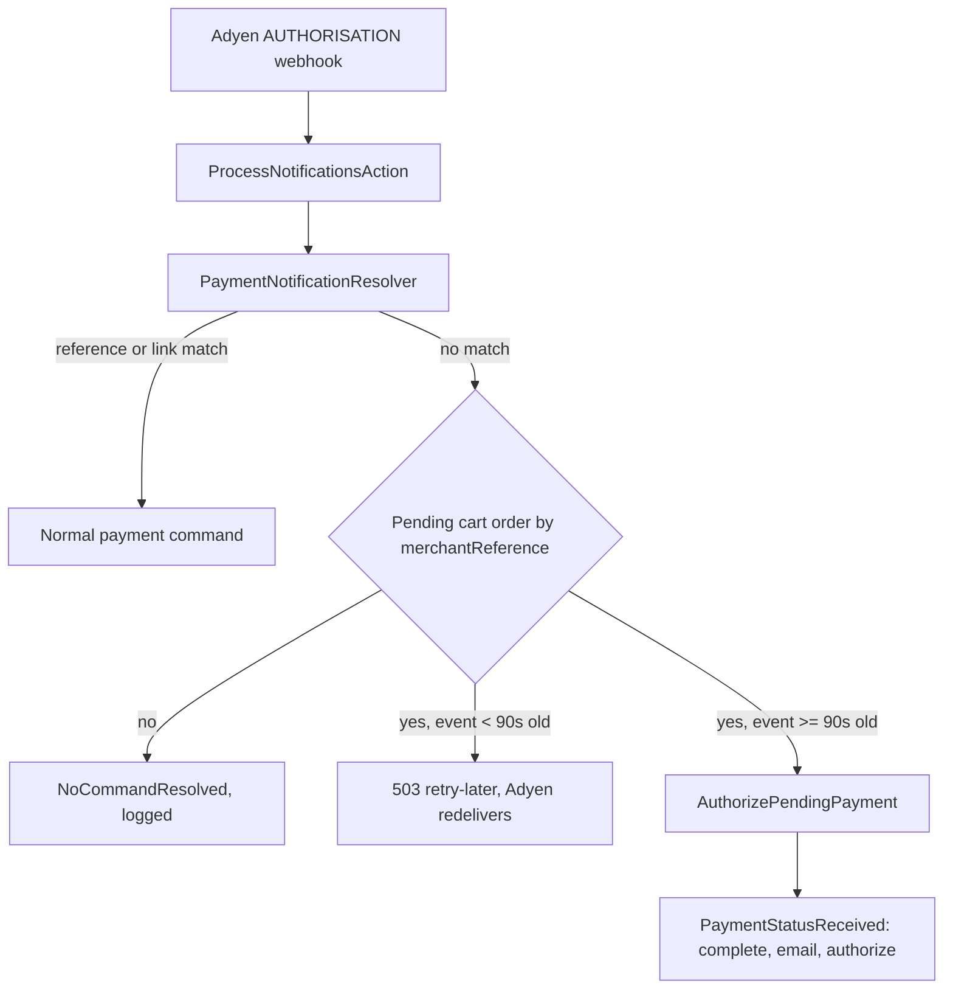

# Bancontact Pay: orders stuck in `cart` after a successful payment

Retrospective record of the changes made to fix Bancontact Pay payments that were debited at Adyen
while the Sylius order stayed in `cart`. Reference case: order `000185191` (2026-10-08).

Throughout this document, statements marked **(inferred)** are conclusions drawn from the code and the
logs, not something observed directly. Statements marked **(not verified)** were not tested end-to-end.

## 1. Problem statement and symptoms

- The customer pays with Bancontact Pay in the banking app. Adyen debits the customer and sends an
  `AUTHORISATION` webhook.
- In the shop, the order never transitions out of `cart`:
  - it is invisible in the admin order list,
  - no order confirmation e-mail is sent,
  - the checkout `complete` transition and the payment authorisation do not run.
- In `sylius_payment.details` the stuck payment still contains the `action` entry (type `qrCode`) and
  `resultCode: Pending`, which is what differs from correctly completed orders.
- The manual workaround is `App\Component\Order\StuckOrderResurrector::resurrect` in the main project
  (`zangra-sylius`), which applies the confirmation steps by hand.

## 2. Evidence from the Adyen logs

Timeline for order `000185191` (all times 2026-10-08, GMT+2):

| Time | Source | Event |
|---|---|---|
| Payment initiation | Adyen `payments` response | `pspReference` `LB2X7X4Q2KNNG6Z3`, `resultCode` `Pending`, `action` of type `qrCode`, `paymentMethodType` `bcmc_mobile`. This is the reference stored in `sylius_adyen_reference` and the details persisted on the payment. |
| 07:18:53 | Webhook (accepted, `[accepted]`) | `AUTHORISATION`, `success: true`, `pspReference` `LJNKD8M8QP8KS6G3`, `paymentMethod` `bcmc_mobile`, `merchantReference` `000185191`, EUR 27.01 (`value: 2701`). No `originalReference`, no `paymentLinkId`. |
| 07:18:53 | `sylius_adyen_log` (x2) | `Payment with pspReference [LJNKD8M8QP8KS6G3] finished with event code [authorisation]` |
| 07:18:54 | `sylius_adyen_log` (x2) | `Tried to dispatch an unknown command. Notification body: ...` |
| 07:18:57 | Adyen `POST /checkout/v71/payments/details` | HTTP 200, `resultCode` `Authorised`, `pspReference` `LJNKD8M8QP8KS6G3`, same amount. Request body contains `redirectResult` only, no `paymentData`. |

Observations:

- The authorisation `pspReference` (`LJNKD...`) differs from the one stored at initiation (`LB2X7...`).
- The `payments/details` call happened about 4 seconds after the webhook, so the customer was on the way
  back to the shop while the webhook was being processed.
- The request body of `payments/details` has no `paymentData`. **(inferred)** It may therefore have been
  issued by `RedirectTargetAction` (redirect return) rather than by the XHR-based `PaymentDetailsAction`.
  Both paths are described in the root cause analysis below.

## 3. Root cause analysis

### Webhook side (established from the logs and code)

1. `ProcessNotificationsAction` asks `PaymentNotificationResolver` for a command.
2. The resolver looks up the payment by `sylius_adyen_reference` using `originalReference` or, if absent,
   the notification's `pspReference`. `LJNKD...` is not stored, so there is no match.
3. The fallback lookup by payment link (`additionalData.paymentLinkId`) also yields nothing.
4. `NoCommandResolvedException` is thrown, the action only logs
   `Tried to dispatch an unknown command` and answers `[accepted]`. Adyen therefore considers the
   notification delivered and does not retry it.

Result: a valid, successful authorisation is silently dropped by the plugin.

### Customer return flow (inferred, root failure not identified)

- After the payment, the customer's return is handled either by `RedirectTargetAction` or by
  `PaymentDetailsAction`. Both end up calling `payments/details` and persisting the result.
- The payment in `sylius_payment.details` still holds `action` and `Pending`. **(inferred)** The result of
  the `payments/details` call at 07:18:57 was therefore never persisted on the payment, even though Adyen
  answered `Authorised`.
- **Open question:** why the return flow failed to persist the result is **not known**. Candidates
  include a failure in the return request itself (exception, session/cart no longer available) or the
  customer not completing the return at all. The webhook cannot have interfered, because at that time it
  changed nothing (it ended in `NoCommandResolvedException`). Answering it needs the production error log
  (e.g. Symfony/web server log) around 07:18:57. This was not available.

### Conclusion (inferred)

Two independent conditions were needed for the order to get stuck: the customer's return flow did not
finalise the checkout, **and** the webhook, which could have served as a safety net, was dropped because its
reference was unknown to the plugin. The change documented below removes the second condition.

## 4. Changes made

The fix was made in two iterations:

1. **Webhook fallback via `merchantReference`.** A successful `authorisation` that matches no known
   reference is matched against a still-open order by order number and finalises it.
2. **Grace period with `503 [retry-later]`.** The first iteration would complete the order inside the webhook,
   i.e. before the customer's own `payments/details` call about 4 seconds later (see timeline). To avoid
   racing the customer's return, the fallback waits for 90 seconds and asks Adyen to redeliver.

### Per file

| File | Change |
|---|---|
| `src/Resolver/Notification/NotificationResolver/PaymentNotificationResolver.php` | New `RepositoryInterface $orderRepository` dependency. When the reference and payment-link lookups throw `NoCommandResolvedException`, it falls back to `fetchPendingPaymentByMerchantReference()` (see guards below) and returns an `AuthorizePendingPayment` command. Adds `PENDING_PAYMENT_GRACE_PERIOD = 90` and `isTooRecent()`, which compares the notification's `eventDate` with now and throws `NotificationRetryRequiredException` while the event is younger than 90 seconds. |
| `src/Resolver/Notification/NotificationResolver/NotificationRetryRequiredException.php` | New exception: the notification must not be acknowledged yet. |
| `src/Bus/Command/AuthorizePendingPayment.php` | New command carrying the `PaymentInterface` and the `NotificationItemData`. Implements `NotificationDataAwarePaymentCommand`. |
| `src/Bus/Handler/AuthorizePendingPaymentHandler.php` | Removes `action` from the payment details, sets `resultCode` to `Authorised` and `pspReference` to the notification's reference, dispatches `PaymentStatusReceived` on the command bus and flushes. |
| `src/Controller/Shop/ProcessNotificationsAction.php` | Catches `NotificationRetryRequiredException`, logs an info line and answers `503` with body `[retry-later]` instead of `[accepted]`, so that Adyen delivers the notification again. |
| `config/services/resolvers.xml` | Passes `sylius.repository.order` to the payment notification resolver. |
| `config/services/bus.xml` | Registers `AuthorizePendingPaymentHandler` (`sylius_adyen.bus.handler.authorize_pending_payment`) on `sylius.command_bus`. |
| `tests/Unit/Resolver/Notification/PaymentNotificationResolverPendingPaymentTest.php` | 5 tests: match by merchant reference, too-recent notification asks for redelivery, order already placed, amount mismatch, failed authorisation. |

### Guards of the `merchantReference` fallback

The fallback is only a last resort, after the reference and payment-link lookups failed. It returns a
payment only if all of the following hold:

- the event code is `authorisation`, `success` is true, and `pspReference` and `merchantReference` are present,
- an order with `number` equal to the `merchantReference` exists,
- the order is still in state `cart`,
- the order has a payment with the same payment method code, in state `cart`, `new` or `processing`,
- that payment has the same amount and currency as the notification (if several qualify, the last one is used).

Otherwise the original `NoCommandResolvedException` is rethrown and the behaviour is unchanged.

### Key decisions

- **Match by `merchantReference` only as a last resort and with strict guards**, because the order number
  is the only identifier the notification and the order have in common when the psp reference is unknown.
- **Reuse `PaymentStatusReceived`** so that the normal flow runs (checkout `complete`, `SendOrderConfirmation`,
  payment authorize/capture) and no logic is duplicated.
- **90 s grace period plus `503` instead of completing immediately**, to avoid racing the customer's own
  return (iteration 2, triggered by the log showing `payments/details` 4 s after the webhook).
- **If `eventDate` is missing or unparseable**, `isTooRecent()` returns `false`, i.e. the order is
  completed without waiting.

## 5. Resulting flow

If the customer returns normally within the grace period, the payment is persisted with the `LJNKD...`
reference. **(inferred)** The redelivered notification then matches by reference and goes through the normal
flow, so the fallback is not used.

## 6. Verification

- `PaymentNotificationResolverPendingPaymentTest`: 5 of 5 tests pass. Run in the container
  `zangra-sylius-php-1`, because the host PHP lacks the `dom` and `xmlwriter` extensions.
- Full unit suite: 536 tests, 10 errors, all in `ClientPayloadFactoryTest`
  (constructor argument-count mismatch). They do not involve the resolver, but were **not checked against
  a baseline** without these changes, so "pre-existing" is an assumption.
- PHPStan stopped with 1 error. **Not investigated**, so it is unknown whether it comes from these changes.
- **Not verified:** no end-to-end test was run against a real or sandbox Bancontact Pay payment, neither
  with the customer returning to the shop nor without. Adyen's actual redelivery behaviour after a `503`
  (timing, number of attempts) was not tested either.

## 7. Known limitations and open items

- **Root cause of the return-flow failure is unknown** (see section 3). The fallback makes the order
  complete anyway, but does not fix whatever broke the customer's return.
- **Remaining race:** if the customer returns later than about 90 seconds after paying, the webhook
  fallback may finalise the order first. The order and the confirmation e-mail are then correct, but the
  customer's browser may show an error.
- **Redelivery depends on Adyen.** The `503` makes Adyen consider the notification undelivered. The retry
  schedule is Adyen's and was not verified. A batch that contains several notification items is answered with
  `503` as a whole if one item requires a retry, so the other items of that request may be delivered again too.
- **Order metadata in `zangra-sylius`:** `UpdateOrderHandler` (reached via `PaymentStatusReceivedHandler`
  and `UpdateOrderCommand`) overwrites `customerIp`, currency and locale from the current request. For an
  order finalised by a webhook, that request is Adyen's, so these values may be wrong. Nothing was changed in
  `zangra-sylius`. Recommendation: skip these overwrites for webhook requests, or only set them when empty.
- Orders that were already stuck before this change are not fixed automatically.

## 8. Deployment and rollout notes

- Commit the changes to the plugin branch `ZNG-43` (`zangra-sylius` requires `sylius/adyen-plugin` at
  `dev-ZNG-43`).
- In `zangra-sylius`, run `composer update sylius/adyen-plugin`, then clear the container cache, because a
  service was added and the constructor of the resolver changed.
- Already-stuck orders: use `StuckOrderResurrector::resurrect`, or have the original webhook redelivered while
  the order is still in `cart`.
- Suggested follow-up: reproduce with a sandbox Bancontact Pay payment where the customer does not return to
  the shop, and with one where the customer returns, then check `sylius_adyen_log` for the info line about a
  notification not being acknowledged yet. Also review the production error log for the return request
  (around the time of the webhook) to find out why the return flow did not persist the result.
