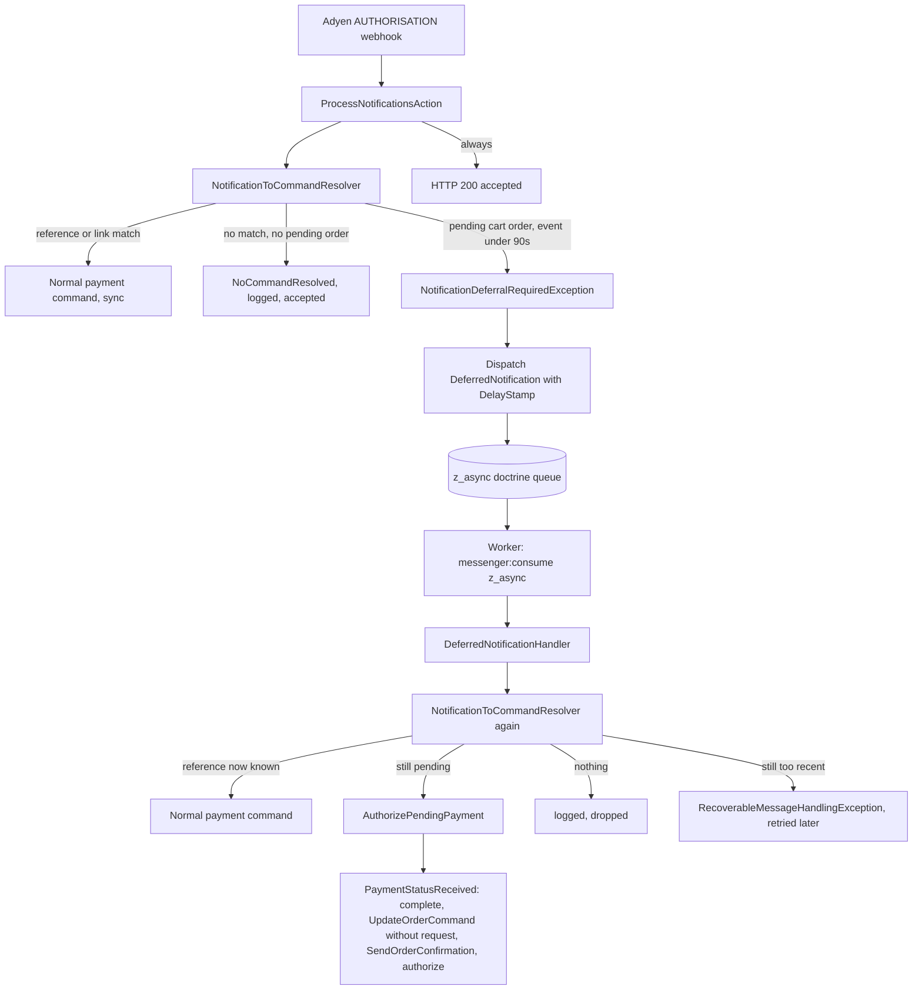

# Bancontact Pay: orders stuck in `cart` after a successful payment

Retrospective record of the changes made to fix Bancontact Pay payments that were debited at Adyen
while the Sylius order stayed in `cart`. Reference case: order `000185191` (2026-10-08).

Throughout this document, statements marked **(inferred)** are conclusions drawn from the code and the
logs, not something observed directly. Statements marked **(not verified)** were not tested end-to-end.

## 1. Problem statement and symptoms

- The customer pays with Bancontact Pay in the banking app. Adyen debits the customer and sends an
  `AUTHORISATION` webhook.
- In the shop, the order never transitions out of `cart`:
  - it is invisible in the admin order list,
  - no order confirmation e-mail is sent,
  - the checkout `complete` transition and the payment authorisation do not run.
- In `sylius_payment.details` the stuck payment still contains the `action` entry (type `qrCode`) and
  `resultCode: Pending`, which is what differs from correctly completed orders.
- The manual workaround is `App\Component\Order\StuckOrderResurrector::resurrect` in the main project
  (`zangra-sylius`), which applies the confirmation steps by hand.

## 2. Evidence from the Adyen logs

Timeline for order `000185191` (all times 2026-10-08, GMT+2):

| Time | Source | Event |
|---|---|---|
| Payment initiation | Adyen `payments` response | `pspReference` `LB2X7X4Q2KNNG6Z3`, `resultCode` `Pending`, `action` of type `qrCode`, `paymentMethodType` `bcmc_mobile`. This is the reference stored in `sylius_adyen_reference` and the details persisted on the payment. |
| 07:18:53 | Webhook (accepted, `[accepted]`) | `AUTHORISATION`, `success: true`, `pspReference` `LJNKD8M8QP8KS6G3`, `paymentMethod` `bcmc_mobile`, `merchantReference` `000185191`, EUR 27.01 (`value: 2701`). No `originalReference`, no `paymentLinkId`. |
| 07:18:53 | `sylius_adyen_log` (x2) | `Payment with pspReference [LJNKD8M8QP8KS6G3] finished with event code [authorisation]` |
| 07:18:54 | `sylius_adyen_log` (x2) | `Tried to dispatch an unknown command. Notification body: ...` |
| 07:18:57 | Adyen `POST /checkout/v71/payments/details` | HTTP 200, `resultCode` `Authorised`, `pspReference` `LJNKD8M8QP8KS6G3`, same amount. Request body contains `redirectResult` only, no `paymentData`. |

Observations:

- The authorisation `pspReference` (`LJNKD...`) differs from the one stored at initiation (`LB2X7...`).
- The `payments/details` call happened about 4 seconds after the webhook, so the customer was on the way
  back to the shop while the webhook was being processed.
- The request body of `payments/details` has no `paymentData`. **(inferred)** It may therefore have been
  issued by `RedirectTargetAction` (redirect return) rather than by the XHR-based `PaymentDetailsAction`.
  Both paths are described in the root cause analysis below.

## 3. Root cause analysis

### Webhook side (established from the logs and code)

1. `ProcessNotificationsAction` asks `PaymentNotificationResolver` for a command.
2. The resolver looks up the payment by `sylius_adyen_reference` using `originalReference` or, if absent,
   the notification's `pspReference`. `LJNKD...` is not stored, so there is no match.
3. The fallback lookup by payment link (`additionalData.paymentLinkId`) also yields nothing.
4. `NoCommandResolvedException` is thrown, the action only logs
   `Tried to dispatch an unknown command` and answers `[accepted]`. Adyen therefore considers the
   notification delivered and does not retry it.

Result: a valid, successful authorisation is silently dropped by the plugin.

### Customer return flow (inferred, root failure not identified)

- After the payment, the customer's return is handled either by `RedirectTargetAction` or by
  `PaymentDetailsAction`. Both end up calling `payments/details` and persisting the result.
- The payment in `sylius_payment.details` still holds `action` and `Pending`. **(inferred)** The result of
  the `payments/details` call at 07:18:57 was therefore never persisted on the payment, even though Adyen
  answered `Authorised`.
- **Open question:** why the return flow failed to persist the result is **not known**. Candidates
  include a failure in the return request itself (exception, session/cart no longer available) or the
  customer not completing the return at all. The webhook cannot have interfered, because at that time it
  changed nothing (it ended in `NoCommandResolvedException`). Answering it needs the production error log
  (e.g. Symfony/web server log) around 07:18:57. This was not available.

### Conclusion (inferred)

Two independent conditions were needed for the order to get stuck: the customer's return flow did not
finalise the checkout, **and** the webhook, which could have served as a safety net, was dropped because its
reference was unknown to the plugin. The change documented below removes the second condition.

## 4. Changes made

The fix was made in three iterations:

1. **Webhook fallback via `merchantReference`.** A successful `authorisation` that matches no known
   reference is matched against a still-open order by order number and finalises it.
2. **Grace period with `503 [retry-later]` (superseded, see "Superseded design" below).** The first iteration
   would complete the order inside the webhook, i.e. before the customer's own `payments/details` call about
   4 seconds later (see timeline). To avoid racing the customer's return, the fallback waited for 90 seconds
   and asked Adyen to redeliver.
3. **Queued, delayed processing (current design).** The endpoint answers `[accepted]` immediately and queues
   a delayed Symfony Messenger message. A worker processes it after the grace period, against fresh state.

### Per file (AdyenPlugin)

| File | Change |
|---|---|
| `src/Resolver/Notification/NotificationResolver/PaymentNotificationResolver.php` | New `RepositoryInterface $orderRepository` dependency. When the reference and payment-link lookups throw `NoCommandResolvedException`, it falls back to `fetchPendingPaymentByMerchantReference()` (see guards below) and returns an `AuthorizePendingPayment` command. Adds `PENDING_PAYMENT_GRACE_PERIOD = 90`. While the notification's `eventDate` is younger than 90 seconds it throws `NotificationDeferralRequiredException` carrying the remaining seconds. |
| `src/Resolver/Notification/NotificationResolver/NotificationDeferralRequiredException.php` | New exception (replaces `NotificationRetryRequiredException`): the notification must be processed later, `getRemainingSeconds()` tells when. |
| `src/Bus/Command/DeferredNotification.php` | New message: `paymentMethodCode` and `NotificationItemData`. Scalars and a plain DTO only, so it serializes safely on an async transport. |
| `src/Bus/Handler/DeferredNotificationHandler.php` | Re-resolves the notification with `NotificationToCommandResolverInterface` and dispatches the resulting command on `sylius.command_bus`. If the event is still too recent it throws `RecoverableMessageHandlingException` with a retry delay. If nothing matches it logs an error on the `adyen` logger and drops the message. |
| `src/Bus/Command/AuthorizePendingPayment.php` | Command carrying the `PaymentInterface` and the `NotificationItemData`. Implements `NotificationDataAwarePaymentCommand`. It is only ever dispatched synchronously, never queued (it holds an entity). |
| `src/Bus/Handler/AuthorizePendingPaymentHandler.php` | Idempotent: returns without changes when the order is no longer in `cart` or the payment is not in `cart`/`new`/`processing`. Otherwise removes `action` from the payment details, sets `resultCode` to `Authorised` and `pspReference` to the notification's reference, dispatches `PaymentStatusReceived` and flushes. Logs an info line on the `adyen` logger for both outcomes (authorized / skipped, see section 9). |
| `src/Controller/Shop/ProcessNotificationsAction.php` | On `NotificationDeferralRequiredException` it dispatches a `DeferredNotification` with `DelayStamp((remaining + 1) * 1000)` and logs an info line. The response is always `200 [accepted]`, the `503 [retry-later]` path is gone. |
| `config/services/resolvers.xml` | Passes `sylius.repository.order` to the payment notification resolver. |
| `config/services/bus.xml` | Registers `AuthorizePendingPaymentHandler` (with the `monolog.logger.adyen` logger) and `DeferredNotificationHandler` (`sylius_adyen.bus.handler.deferred_notification`) on `sylius.command_bus`. |
| `tests/Unit/Resolver/Notification/PaymentNotificationResolverPendingPaymentTest.php` | 5 tests: match by merchant reference, too-recent notification asks for deferral (with remaining seconds), order already placed, amount mismatch, failed authorisation. |
| `tests/Unit/Controller/Shop/ProcessNotificationsActionDeferralTest.php` | 3 tests: delayed message queued with the expected `DelayStamp` and a `200 [accepted]` response, normal command dispatched without queuing, unresolved notification not queued. |
| `tests/Unit/Bus/Handler/DeferredNotificationHandlerTest.php` | 4 tests: normal command, pending-payment command, still too recent (retry delay), nothing resolved (logged and dropped). |
| `tests/Unit/Bus/Handler/AuthorizePendingPaymentHandlerTest.php` | Authorises a pending payment, and does nothing for an order out of `cart` or a completed/failed payment. Both cases assert the log line. |

### Per file (main project `zangra-sylius`)

| File | Change |
|---|---|
| `config/packages/messenger.yaml` | Routes `Sylius\AdyenPlugin\Bus\Command\DeferredNotification` to the existing `z_async` transport. The plugin cannot know the transport name, so routing lives in the host application. |
| `src/Bus/Message/UpdateOrderCommand.php` | The `Request` is now nullable. |
| `src/Bus/Handler/UpdateOrderHandler.php` | `customerIp`, currency and locale are only set when a request exists. In a worker (no request) the order keeps its own values and the currency/locale contexts are not called. This also removes the earlier caveat that Adyen's webhook request overwrote these values. |

### Guards of the `merchantReference` fallback

The fallback is only a last resort, after the reference and payment-link lookups failed. It returns a
payment only if all of the following hold:

- the event code is `authorisation`, `success` is true, and `pspReference` and `merchantReference` are present,
- an order with `number` equal to the `merchantReference` exists,
- the order is still in state `cart`,
- the order has a payment with the same payment method code, in state `cart`, `new` or `processing`,
- that payment has the same amount and currency as the notification (if several qualify, the last one is used).

Otherwise the original `NoCommandResolvedException` is rethrown and the behaviour is unchanged.

### Key decisions

- **Match by `merchantReference` only as a last resort and with strict guards**, because the order number
  is the only identifier the notification and the order have in common when the psp reference is unknown.
- **Queue only the pending-payment case.** Everything else stays synchronous. Queuing all notifications was
  considered and not done.
- **The message carries scalars and a DTO, never entities.** The worker re-runs the resolver against fresh
  state. That covers both outcomes: the customer returned (reference now known, normal command) or did not
  (`AuthorizePendingPayment`).
- **The controller sets the delay** (remaining grace time + 1 s). The resolver keeps its `eventDate` check, so
  the same code serves the intake (defer) and the worker (process).
- **Safety net.** If the worker still finds the event too recent (for example the message is routed `sync`,
  or clocks differ), the handler throws `RecoverableMessageHandlingException` with a retry delay. Async:
  Messenger retries later. Sync: the webhook request fails and Adyen retries, i.e. the old behaviour.
- **Reuse `PaymentStatusReceived`** so that the normal flow runs (checkout `complete`, `SendOrderConfirmation`,
  payment authorize/capture) and no logic is duplicated.
- **Idempotency in `AuthorizePendingPaymentHandler`**, because Adyen may deliver the same notification more
  than once (three deliveries within 0.6 s were seen).
- **If `eventDate` is missing or unparseable**, no deferral happens and the order is completed without waiting.

### Superseded design: `503 [retry-later]`

The second iteration answered `503 [retry-later]` while the event was younger than 90 s, so Adyen would
redeliver. In production it worked (order `000185432`: three `Failed` deliveries, then `Accepted`), but it was
dropped because:

- Adyen counts every non-2xx as a failed delivery: dashboard "Failed" entries, a `Failing` endpoint status and
  failure alerts after repeated retries.
- Adyen's retry queue is per endpoint, so a slow Bancontact order could hold up unrelated webhooks.
- Redelivery timing is Adyen's, not tied to the grace period, and one `503` re-sends the whole batch.

## 5. Resulting flow



If the customer returns normally within the grace period, the payment is persisted with the `LJNKD...`
reference. **(inferred)** When the worker runs, the notification then matches by reference and goes through the
normal flow, so the fallback is not used.

## 6. Verification

- Unit tests (run in the container image `zangra-sylius-php`, because the host PHP lacks the `dom` and
  `xmlwriter` extensions): `PaymentNotificationResolverPendingPaymentTest` (5), `ProcessNotificationsActionDeferralTest` (3),
  `DeferredNotificationHandlerTest` (4) and `AuthorizePendingPaymentHandlerTest` (4 cases) pass.
- Full unit suite: 547 tests, 10 errors, all in `ClientPayloadFactoryTest` (constructor argument-count mismatch).
  They do not involve this change, but were **not checked against a baseline**, so "pre-existing" is an assumption.
- `zangra-sylius`: `php -l` is clean for the changed PHP files. With the plugin mounted into the container,
  the kernel compiles and `debug:messenger` shows `DeferredNotification` handled by
  `sylius_adyen.bus.handler.deferred_notification` on `sylius.command_bus`. `lint:container` could not finish
  in the sandbox because it tried to reach the database host `db`.
- **Not verified:** no end-to-end run with a real worker, neither against a real or sandbox Bancontact Pay
  payment, nor with `messenger:consume`. There is no automated test for `UpdateOrderHandler` with a `null`
  request. PHPStan stopped with 1 error earlier, which was not investigated.
- The monitoring queries in section 9 were written from the code and the `zangra-sylius` Messenger config and
  were **not run against a real database**. Check them against your schema first.
- First production observation of the superseded `503` design: see "Superseded design" above. The queued
  design has not been observed in production yet.

## 7. Known limitations and open items

- **Root cause of the return-flow failure is unknown** (see section 3). The fallback makes the order
  complete anyway, but does not fix whatever broke the customer's return.
- **A worker is required.** Without a running `messenger:consume z_async`, the paid order stays in `cart`
  and the messages stay in the queue. In `zangra-sylius` a `z_async` worker is already needed for
  `SendOrderConfirmation`, and `docker-compose.yml` has a `worker` service, but no supervisor/systemd
  definition is in the repository. Production supervision must be checked.
- **Routing must be deployed.** If `DeferredNotification` is not routed to a transport it is handled
  synchronously. The handler then throws `RecoverableMessageHandlingException` (event too recent), the webhook
  fails and Adyen retries, which is the old `503` behaviour.
- **`customerIp` stays empty** for orders finalised by the worker, because no HTTP request is available.
  Before this change it held Adyen's IP, which was not useful either. Currency and locale keep the values
  the order already had.
- **Duplicates and parallel workers.** The idempotency guard in `AuthorizePendingPaymentHandler` and the
  Doctrine transaction middleware reduce the risk, but two copies of the same notification handled by two
  workers at the same time are not strictly excluded. A lock keyed on `merchantReference` (`zangra-sylius`
  already has `framework.lock`) is a possible follow-up, not planned.
- **Remaining race:** if the customer returns after the worker ran (more than about 90 seconds after
  paying), the worker may have finalised the order first. The order and the confirmation e-mail are then
  correct, but the customer's browser may show an error.
- **Only the pending-payment case is queued.** Other notifications stay synchronous. Queuing everything is a
  possible later change.
- Orders that were already stuck before this change are not fixed automatically.

## 8. Deployment and rollout notes

- Commit the plugin changes to the plugin branch `zs2.0` (`zangra-sylius` requires `sylius/adyen-plugin` at
  `dev-zs2.0`). Run `composer update sylius/adyen-plugin` in `zangra-sylius` and clear the cache.
- **Deploy order matters:** `messenger.yaml` in `zangra-sylius` routes a class that only exists in the new
  plugin version. Deploying the routing with the old plugin makes the kernel fail with "Invalid Messenger
  routing configuration: class or interface ... not found". Update the plugin and the host application together.
- Rollout checklist:
  1. A supervised `messenger:consume z_async` runs in production (restart on failure and on deploy).
  2. The transport tables exist: run `messenger:setup-transports` (the `z_async` queue is `zangra_default`,
     the failure transport `failed` is Doctrine based).
  3. The routing for `DeferredNotification` is deployed together with the plugin update.
  4. Monitor `messenger:stats` and `messenger:failed:show` after the first Bancontact Pay payments.
- Already-stuck orders: use `StuckOrderResurrector::resurrect`, or have the original webhook redelivered while
  the order is still in `cart`.
- Suggested follow-up: reproduce with a sandbox Bancontact Pay payment where the customer does not return to
  the shop, and with one where the customer returns, then check `sylius_adyen_log` for the info line about the
  notification being queued and the resulting order state. Also review the production error log for the return
  request to find out why the return flow did not persist the result.

## 9. Monitoring

The path has four observable stages: intake log, queue, worker, outcome. The queries are untested
**(not verified)**, adapt them to the real schema.

### 9.1 Intake and handler log (`sylius_adyen_log`, columns `token`, `level`, `error_code`, `message`, `date_time`)

| Message (substring) | Level | Meaning |
|---|---|---|
| `was queued for processing in N seconds` | info | Fallback hit, a delayed message was created. Start marker. Not an error. |
| `Pending payment of order [X] was authorized from notification [Y]` | info | `AuthorizePendingPaymentHandler` completed the order. Success marker. |
| `Pending payment of order [X] was not authorized from notification [Y]: skipped, already processed` | info | Idempotency guard: duplicate notification, or the customer's return finished the order first. |
| `Tried to dispatch an unknown command` | error | Nothing matched at intake. A successful Bancontact `authorisation` here is a problem. |
| `Deferred notification could not be resolved to a command` | error | The worker found nothing to do (amount/currency mismatch, order placed without a reference match). Always investigate. |

```sql
-- fallback hits per day
SELECT DATE(date_time) d, COUNT(*) FROM sylius_adyen_log
WHERE message LIKE '%was queued for processing%' GROUP BY d ORDER BY d DESC;

-- orders completed by the fallback per day
SELECT DATE(date_time) d, COUNT(*) FROM sylius_adyen_log
WHERE message LIKE 'Pending payment of order%was authorized from notification%' GROUP BY d ORDER BY d DESC;

-- worker could not resolve a deferred notification (should be ~0)
SELECT * FROM sylius_adyen_log
WHERE message LIKE 'Deferred notification could not be resolved%' ORDER BY id DESC;
```

Healthy sequence for one order: a "queued" line, then after about 90 s either "was authorized from
notification" (the customer did not return) or the "skipped, already processed" line / no handler line at all
(the customer returned and the normal flow ran).

### 9.2 Messenger queue

```bash
bin/console messenger:stats
bin/console messenger:failed:show
bin/console messenger:failed:show <id> -vv
bin/console messenger:failed:retry <id>
```

```sql
-- pending deferred notifications with due time
SELECT id, created_at, available_at, delivered_at FROM messenger_messages
WHERE queue_name = 'zangra_default' AND headers LIKE '%DeferredNotification%' ORDER BY available_at;

-- failed ones
SELECT id, created_at, headers FROM messenger_messages
WHERE queue_name = 'failed' AND headers LIKE '%DeferredNotification%';
```

- **Overdue message** (`available_at` more than about 5 minutes in the past, `delivered_at IS NULL`): the worker
  is not running or is stuck. This is the most important alarm, because paid orders stay in `cart`.
- **Row in `failed`:** retries are exhausted, a real error.
- **Old `delivered_at`:** the worker crashed while handling.

### 9.3 Worker log

`bin/console messenger:consume z_async -vv`, or `docker compose logs -f worker`. A single Messenger warning
"Retrying" with "is still too recent" is harmless. Repeated ones mean the worker runs early or the message is
routed `sync`.

### 9.4 Outcome check

Proof that the order was finalised is the order state, not a log line.

```sql
-- payments that still have an 'action', in a cart older than 15 minutes (includes abandoned carts)
SELECT o.number, o.state, o.checkout_state, p.state, p.updated_at
FROM sylius_payment p JOIN sylius_order o ON o.id = p.order_id
WHERE o.state = 'cart' AND p.details LIKE '%"action"%' AND p.updated_at < NOW() - INTERVAL 15 MINUTE;
```

Compare with the order numbers from the error lines above. The combination to alert on is: a successful
`authorisation` from Adyen and the order still in `cart` after about 3 minutes. A cron job mailing a non-empty
result is a minimal alarm. No alarm exists in the code yet.

### 9.5 Adyen side

The Customer Area webhook event log should show only **Accepted**. A "Failed" entry is a new problem (exception
at intake or a 5xx), because this path no longer returns `503`.
